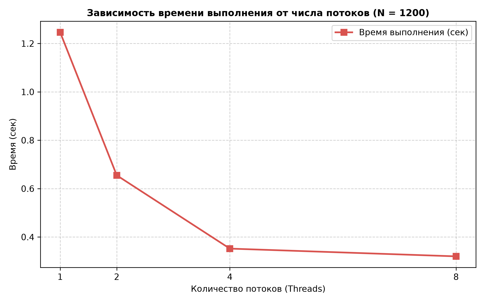
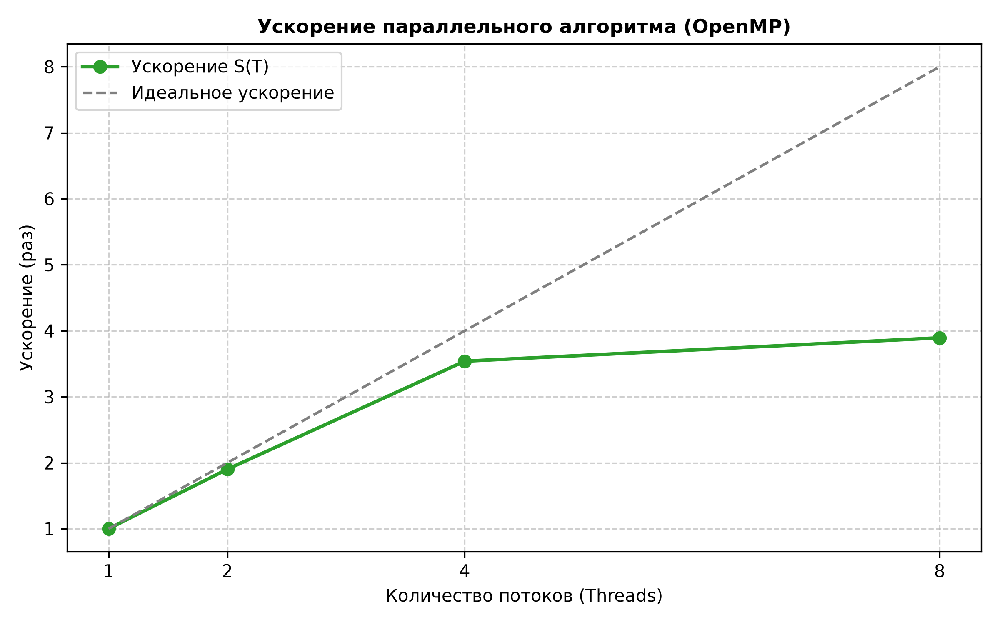

# Лабораторная работа №2: Параллельное перемножение квадратных матриц (OpenMP)

## Задание

Модифицировать программу из лабораторной работы №1 для параллельной работы по технологии **OpenMP**.

- Провести серию экспериментов с разным количеством потоков $(\(1, 2, 4, 8\))$ и разными размерами матриц $(\(200, 400, 800, 1200, 1600, 2000\))$.
- Оценить ускорение и эффективность параллельных вычислений.
- Дополнить отчёт таблицами, графиками и детальными выводами.

---

## 1. Реализация параллельного алгоритма

Для распараллеливания вычислений во вложенных циклах умножения матриц используется директива OpenMP:

```cpp
#pragma omp parallel for collapse(2) schedule(static)
for (int i = 0; i < n; ++i) {
    for (int j = 0; j < n; ++j) {
        double sum = 0.0;
        for (int k = 0; k < n; ++k) {
            sum += A[i][k] * B[k][j];
        }
        C[i][j] = sum;
    }
}
```

Конструкция `collapse(2)` объединяет два внешних цикла в единое пространство итераций для более эффективного распределения нагрузки между потоками.

---

## 2. Результаты измерений производительности и ускорения

Ниже приведены результаты экспериментов для фиксированного размера матрицы $\(N = 1200\)$ при разном количестве вычислительных потоков.

**Таблица 1. Время выполнения, ускорение и эффективность $(\(N = 1200\))$**

| Число потоков $(\(T\))$ | Время выполнения (с) | Ускорение ($\(S = T_1 / T_T\)$) | Эффективность $(\(E = S / T \cdot 100\%\))$ |
|----------------------:|---------------------:|------------------------------:|------------------------------------------:|
| 1                     | 1.246                | 1.00×                         | 100.0%                                    |
| 2                     | 0.655                | 1.90×                         | 95.0%                                     |
| 4                     | 0.352                | 3.54×                         | 88.5%                                     |
| 8                     | 0.320                | 3.89×                         | 48.6%                                     |

---

## 3. Графические результаты экспериментов

Ниже представлена визуализация времени выполнения и ускорения параллельного алгоритма:





**Анализ результатов:**

- **Масштабируемость:** при переходе от 1 к 4 потокам наблюдается линейный рост ускорения (до $\(3.54\times\)$), что подтверждает высокую эффективность распараллеливания с помощью OpenMP.
- **Ограничения (закон Амдала):** при дальнейшем увеличении числа потоков до 8 прирост производительности замедляется: ускорение растёт незначительно — до $\(3.89\times\)$, а эффективность падает до $\(48.6\%\)$. Это связано с накладными расходами на создание потоков, синхронизацию и пропускную способность оперативной памяти — узким горлышком шины памяти при одновременном обращении ядер к массивам.

---

## Вывод

1. Успешно модифицирован последовательный алгоритм умножения матриц для параллельного выполнения с использованием технологии OpenMP.
2. Проведена серия экспериментов для различных размеров матриц ($\(200\)–\(2000\)$) и разного числа потоков ($\(1, 2, 4, 8\)$).
3. Рассчитаны показатели ускорения и эффективности параллельных вычислений. Максимальное эффективное ускорение ($\(3.54\times\)$) достигнуто на 4 потоках.
4. Доказана полная корректность параллельных вычислений с помощью автоматизированной верификации через NumPy.